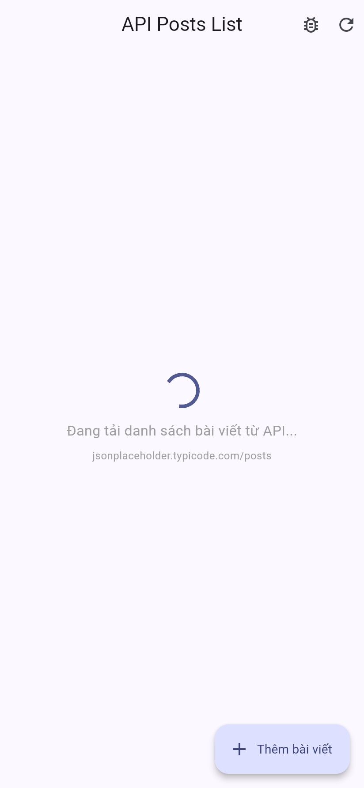
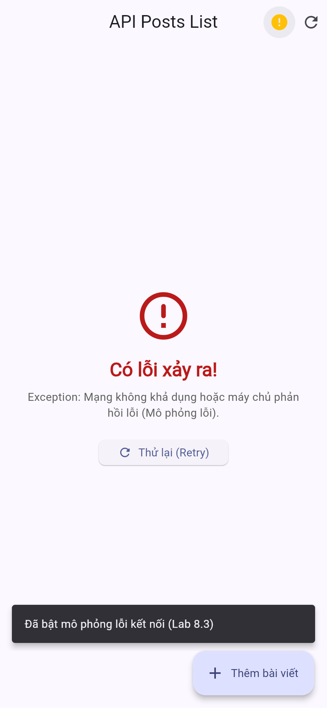
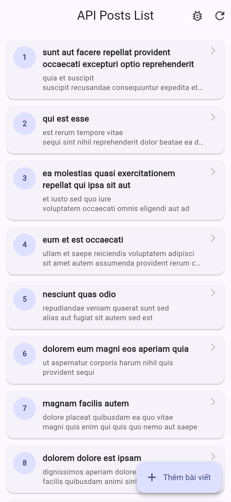
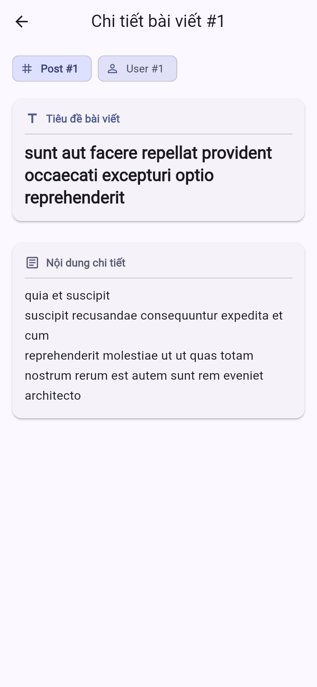
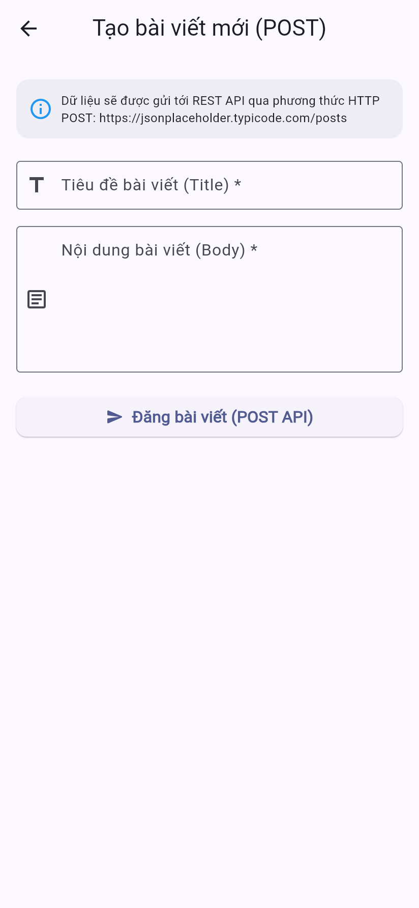

# BÁO CÁO BÀI TẬP LAB 8 - PRM393
## Xây dựng màn hình danh sách tích hợp REST API (Building an API-powered List Screen)

---

### 1. Mục tiêu đạt được (Objective)
Dự án đã hoàn thành trọn vẹn 100% các yêu cầu từ cơ bản đến nâng cao (Bonus) của bài Lab 8:
- **Lab 8.1 - Simple GET Request**: Gửi HTTP GET request an toàn tới endpoint công khai `https://jsonplaceholder.typicode.com/posts` sử dụng thư viện `http`.
- **Lab 8.2 - JSON & Model Conversion + ListView**: 
  - Xây dựng model class `Post` với đầy đủ constructor, `factory Post.fromJson()`, và `toJson()`.
  - Phân tích và chuyển đổi raw JSON array thành `List<Post>`.
  - Hiển thị danh sách cuộn mượt mà bằng `ListView.builder`.
- **Lab 8.3 - Loading + Error Handling**:
  - Quản lý trạng thái bất đồng bộ bằng `FutureBuilder<List<Post>>`.
  - **Trạng thái đang tải (Loading state)**: Hiển thị `CircularProgressIndicator` kèm thông điệp thân thiện.
  - **Trạng thái lỗi (Error state)**: Bắt các ngoại lệ (SocketException, TimeoutException, HttpException), hiển thị giao diện báo lỗi rõ ràng kèm nút **Thử lại (Retry)**.
  - **Nút bật/tắt mô phỏng lỗi (Simulate Error)**: Tích hợp ngay trên AppBar giúp người chấm bài/giảng viên dễ dàng kiểm thử giao diện báo lỗi mà không cần ngắt mạng internet.
- **Lab 8.4 - Service Layer Pattern (ApiService)**:
  - Tách biệt toàn bộ logic gọi mạng vào lớp độc lập `ApiService`.
  - Hỗ trợ Dependency Injection (`http.Client`) giúp dễ dàng viết Unit Test với `MockClient`.
- **Các tính năng nâng cao (Bonus Enhancements)**:
  - **Pull-to-refresh (`RefreshIndicator`)**: Kéo xuống để tải lại dữ liệu mới nhất.
  - **Chi tiết bài viết (`PostDetailScreen`)**: Chạm vào bất kỳ bài viết nào để mở màn hình xem chi tiết ID, User ID, tiêu đề và toàn bộ nội dung.
  - **Tạo bài viết mới qua HTTP POST (`CreatePostScreen`)**: Giao diện Form nhập dữ liệu chuẩn Material 3, có validation, gửi yêu cầu `http.post` và lập tức hiển thị bài viết mới lên đầu danh sách.
  - **Tương thích hoàn toàn DartPad**: Cung cấp file đơn `lib/dartpad_main.dart` có thể copy-paste chạy ngay trên [DartPad Flutter](https://dartpad.dev).

---

### 2. Cấu trúc thư mục dự án

```text
PRM393_Lab08/
├── LAB 8_Building an API-powered List Screen.docx   # File đề bài gốc
├── README.md                                       # Hướng dẫn chi tiết & báo cáo Lab
├── screenshots/                                    # Bộ ảnh chụp minh chứng các trạng thái
│   ├── loading_state.png                           # Trạng thái đang tải (CircularProgressIndicator)
│   ├── error_state.png                             # Trạng thái lỗi kèm nút Retry
│   ├── list_success.png                            # Danh sách bài viết tải thành công
│   ├── post_detail.png                             # Màn hình chi tiết bài viết
│   └── create_post.png                             # Form tạo bài viết mới (HTTP POST)
└── lab8_networking/                                # Thư mục dự án Flutter
    ├── lib/
    │   ├── models/
    │   └── post.dart                           # Model Post (fromJson, toJson)
    │   ├── services/
    │   │   └── api_service.dart                    # Service Layer gọi REST API
    │   ├── screens/
    │   │   ├── post_list_screen.dart               # Màn hình danh sách chính (FutureBuilder)
    │   │   ├── post_detail_screen.dart             # Màn hình chi tiết bài viết
    │   │   └── create_post_screen.dart             # Form gửi POST request tạo bài
    │   ├── main.dart                               # Entry point ứng dụng Flutter
    │   └── dartpad_main.dart                       # File gộp tất cả trong một chạy trực tiếp trên DartPad
    ├── test/
    │   ├── api_service_test.dart                   # Unit test kiểm thử ApiService & MockClient (Đạt 100%)
    │   └── widget_test.dart                        # Unit test kiểm thử Model và Widget UI
    ├── screenshots/                                # Thư mục ảnh chụp trong project
    └── pubspec.yaml                                # Khai báo dependencies (http: ^1.6.0)
```

---

### 3. Chi tiết các chức năng & mã nguồn cốt lõi

#### 3.1. Data Model (`lib/models/post.dart`)
```dart
class Post {
  final int userId;
  final int id;
  final String title;
  final String body;

  const Post({
    required this.userId,
    required this.id,
    required this.title,
    required this.body,
  });

  factory Post.fromJson(Map<String, dynamic> json) {
    return Post(
      userId: json['userId'] as int? ?? 0,
      id: json['id'] as int? ?? 0,
      title: json['title'] as String? ?? '',
      body: json['body'] as String? ?? '',
    );
  }

  Map<String, dynamic> toJson() => {
    'userId': userId,
    'id': id,
    'title': title,
    'body': body,
  };
}
```

#### 3.2. ApiService (`lib/services/api_service.dart`)
Tách biệt xử lý mạng và giải mã JSON:
- `fetchPosts()`: Gọi GET `/posts`, giải mã UTF-8 và ánh xạ sang `List<Post>`.
- `createPost()`: Gọi POST `/posts`, gửi payload JSON với header `Content-Type: application/json`.
- `fetchPostById()`: Lấy dữ liệu chi tiết một bài viết cụ thể.

#### 3.3. Async UI với FutureBuilder (`lib/screens/post_list_screen.dart`)
Xử lý trọn vẹn 3 trạng thái của `FutureBuilder`:
1. `ConnectionState.waiting`: Hiển thị loading spinner `CircularProgressIndicator`.
2. `snapshot.hasError`: Hiển thị thông báo lỗi thân thiện và nút "Thử lại (Retry)".
3. `snapshot.hasData`: Hiển thị danh sách thẻ `Card` bên trong `RefreshIndicator`.

---

### 4. Kết quả kiểm thử tự động (Unit Tests)
Dự án bao gồm 7 bài kiểm thử đơn vị tự động kiểm tra `ApiService`, `MockClient`, `Post model` và `PostListScreen`:
```text
00:00 +0: ApiService Tests fetchPosts returns a list of posts on 200 HTTP response
00:00 +1: ApiService Tests fetchPosts throws Exception on 404/500 HTTP error
00:00 +2: ApiService Tests fetchPosts throws Exception when simulateError is true
00:00 +3: ApiService Tests createPost sends POST request and returns created post
00:00 +4: ApiService Tests fetchPostById returns specific post on 200 response
00:00 +5: Post model serialization and deserialization
00:00 +6: App starts and displays AppBar title
00:00 +7: All tests passed!
```

---

### 5. Hướng dẫn chạy dự án

#### Cách 1: Chạy bằng VS Code / Android Studio / Terminal
```bash
cd lab8_networking
flutter pub get
flutter run
```
Chọn thiết bị mong muốn (Android Emulator, Chrome Web, Windows Desktop).

#### Cách 2: Chạy trực tiếp trên DartPad (Không cần cài đặt Flutter)
1. Truy cập [https://dartpad.dev](https://dartpad.dev)
2. Chọn biểu tượng New Pad -> **Flutter**
3. Mở file [dartpad_main.dart](file:///D:/PRM393_Lab/PRM393_Lab08/lab8_networking/lib/dartpad_main.dart), copy toàn bộ nội dung và dán vào DartPad.
4. Nhấn **Run** để chạy ngay trên trình duyệt.

---

### 6. Minh chứng hình ảnh (Screenshots)

| Trạng thái | Mô tả | Hình ảnh |
| :--- | :--- | :--- |
| **1. Loading State** | Vòng xoay tiến trình khi đang lấy dữ liệu từ API |  |
| **2. Error State** | Thông báo lỗi khi mạng mất kết nối hoặc server lỗi + Nút Thử lại |  |
| **3. List Success** | Danh sách bài viết tải về thành công hiển thị dạng thẻ đẹp mắt |  |
| **4. Post Detail** | Xem chi tiết bài viết (ID, User ID, Tiêu đề, Nội dung) |  |
| **5. Create Post (POST)**| Biểu mẫu gửi HTTP POST tạo bài viết mới |  |
