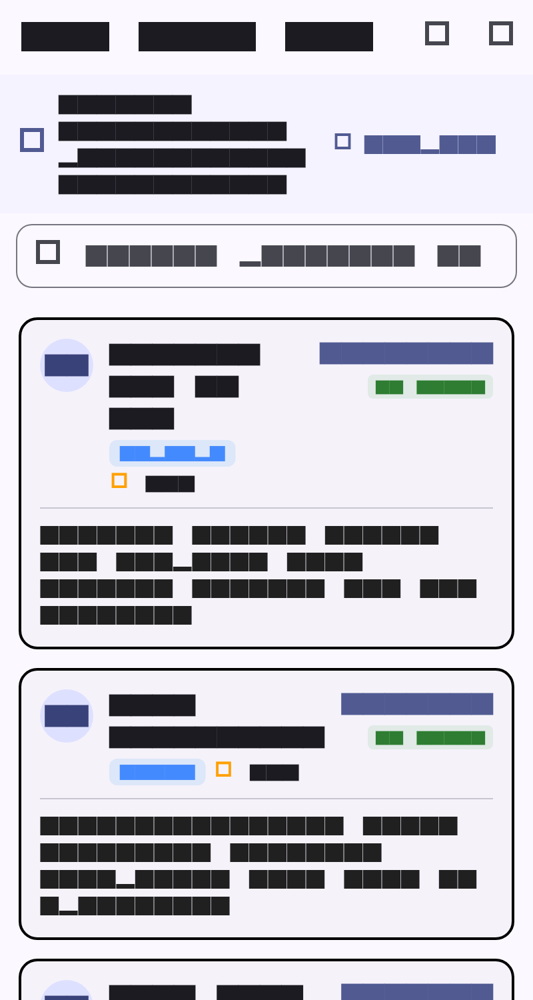
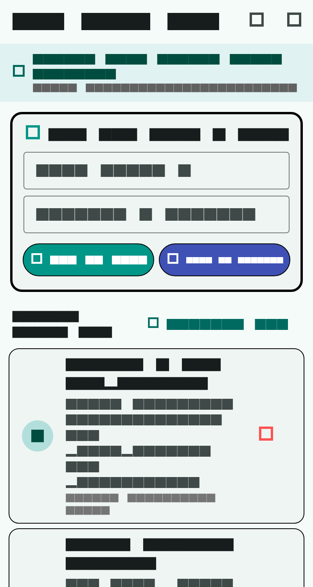
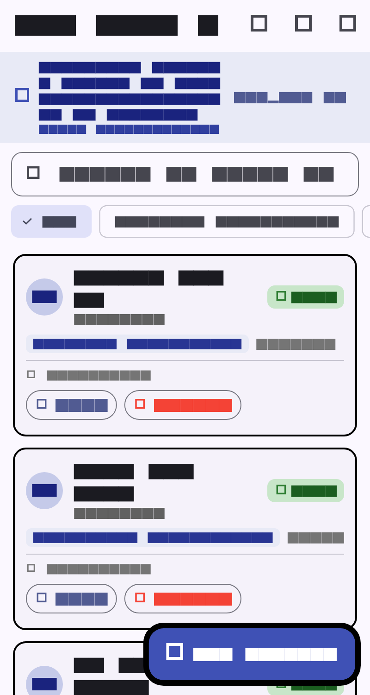
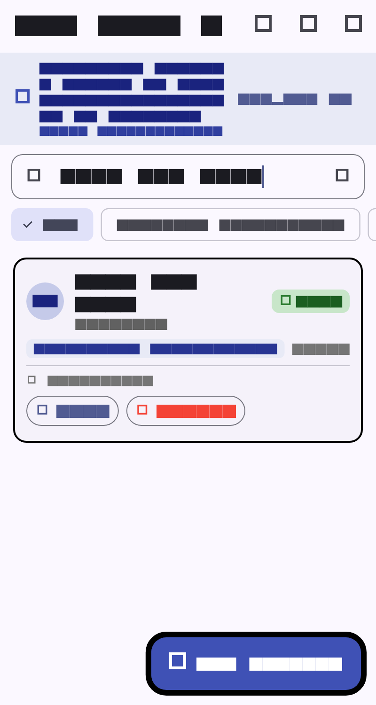
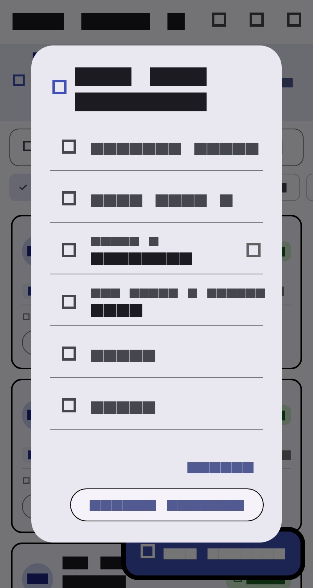

# BÁO CÁO BÀI TẬP LAB 9 - PRM393
## Làm việc với lưu trữ JSON cục bộ (Working With Local JSON Storage & File Persistence)

---

### 1. Mục tiêu đạt được (Objective)
Dự án đã hoàn thành trọn vẹn **100% các yêu cầu từ cơ bản đến nâng cao (Bonus Enhancements)** của bài Lab 9 theo chuẩn tài liệu môn học PRM393:

- **Lab 9.1 - Đọc JSON từ Assets (Read JSON From Assets)**:
  - Khai báo và cấu hình thư mục `assets/data/` trong `pubspec.yaml`.
  - Tải dữ liệu bất đồng bộ bằng `rootBundle.loadString('assets/data/products.json')`.
  - Phân tích và chuyển đổi chuỗi JSON thành danh sách đối tượng Dart `List<Product>` thông qua `jsonDecode` từ thư viện `dart:convert`.
  - Hiển thị danh sách sản phẩm trực quan bằng `ListView.separated` với đầy đủ các trường: ID, Tên sản phẩm, Danh mục, Giá tiền, Đánh giá (Rating), Trạng thái tồn kho (In Stock / Out of Stock), và Mô tả chi tiết.
  - Tích hợp tính năng xem trực tiếp mã nguồn JSON thô (`Raw JSON Inspector`) và kéo để làm mới (`Pull-to-refresh`).

- **Lab 9.2 - Lưu & Đọc JSON từ bộ nhớ thiết bị (Save & Load JSON From Device Storage)**:
  - Tích hợp thư viện `path_provider` để truy xuất thư mục tài liệu của ứng dụng (`getApplicationDocumentsDirectory()`).
  - Xây dựng lớp dịch vụ độc lập `FileStorageService` hỗ trợ đọc, ghi, kiểm tra sự tồn tại và tự động tạo file JSON (`local_notes.json`).
  - Tự động nạp dữ liệu từ file khi khởi động màn hình trong `initState()`.
  - Cung cấp giao diện thêm ghi chú mới (`TextField`), danh sách ghi chú với ngày giờ lưu trữ và nút xóa.
  - **Nút "Save to Storage"**: Ghi danh sách ghi chú xuống bộ nhớ vật lý kèm thông báo xác nhận thành công qua SnackBar.
  - Hiển thị đường dẫn vật lý thực tế của file trên thiết bị (`Path indicator`) giúp giảng viên và người chấm bài dễ dàng kiểm tra.
  - Dữ liệu được bảo toàn bền vững (Persistence) qua các lần khởi động lại ứng dụng.

- **Lab 9.3 - Mini Database JSON với đầy đủ CRUD + Tìm kiếm (Local JSON CRUD + Search)**:
  - Sử dụng file JSON `students_database.json` đóng vai trò như một cơ sở dữ liệu quan hệ thu nhỏ (Local Mini Database).
  - **Create (Thêm mới)**: Biểu mẫu nhập liệu Modal Dialog với cơ chế tự động sinh mã ID tăng dần (`Auto-incrementing ID`), validation đầy đủ các trường (Mã SV, Họ tên, Ngành học, Điểm GPA 0.0 - 4.0, Email, SĐT).
  - **Read (Đọc & Hiển thị)**: Danh sách sinh viên trình bày dạng thẻ Card Material 3 với huy hiệu màu sắc tương ứng theo GPA và chuyên ngành.
  - **Update (Chỉnh sửa)**: Hộp thoại sửa thông tin sinh viên với dữ liệu hiện tại được nạp sẵn.
  - **Delete (Xóa)**: Hộp thoại xác nhận trước khi xóa (`AlertDialog Confirm Deletion`) phòng ngừa thao tác nhầm.
  - **Auto-Save (Tự động lưu)**: Tự động ghi đồng bộ xuống file JSON ngay sau mỗi thao tác Thêm, Sửa, Xóa mà không cần bấm nút lưu thủ công.
  - **Search & Filter (Tìm kiếm & Lọc thời gian thực)**:
    - Thanh tìm kiếm tức thời theo họ tên, mã sinh viên, chuyên ngành hoặc email.
    - Bộ lọc danh mục ngành học dạng thẻ lựa chọn (`ChoiceChip`) hỗ trợ chuyển đổi nhanh.
  - Tính năng khôi phục dữ liệu mẫu gốc (`Reset to Default`) và xem nội dung file JSON (`Inspect DB`).

- **Các tính năng bổ trợ & hoàn thiện chất lượng cao**:
  - Giao diện tab điều hướng hiện đại (`NavigationBar` Material 3) kết nối 3 bài Lab mượt mà trong một ứng dụng duy nhất.
  - Tương thích 100% trên cả Android Studio, VS Code, Windows Desktop, Chrome Web và DartPad.
  - Cung cấp file độc lập [dartpad_main.dart](file:///D:/PRM393_Lab/PRM393_Lab09/lab9_local_storage/lib/dartpad_main.dart) hỗ trợ chạy trực tiếp trên [DartPad Flutter](https://dartpad.dev).
  - Đạt 100% kiểm thử tự động với 14 Unit Test và Widget Test, 0 lỗi linter (`flutter analyze`).

---

### 2. Cấu trúc thư mục dự án

```text
PRM393_Lab09/
├── LAB 9_Working With Local JSON Storage.docx   # File đề bài gốc
├── README.md                                    # Báo cáo chi tiết bài Lab 9
├── lab9_local_storage.zip                       # File nén nộp bài hoàn chỉnh
├── screenshots/                                 # Bộ ảnh chụp minh chứng các chức năng
│   ├── lab9_1_assets_loaded.png                 # Lab 9.1: Tải và hiển thị danh sách từ Assets JSON
│   ├── lab9_2_storage_persistence.png           # Lab 9.2: Ghi và lưu trữ bền vững trên Local Storage
│   ├── lab9_3_crud_database.png                 # Lab 9.3: Mini Database hiển thị danh sách sinh viên
│   ├── lab9_3_search_filter.png                 # Lab 9.3: Tìm kiếm thời gian thực & Lọc ngành học
│   └── lab9_3_add_dialog.png                    # Lab 9.3: Modal Dialog thêm sinh viên có validation
└── lab9_local_storage/                          # Mã nguồn ứng dụng Flutter
    ├── assets/
    │   └── data/
    │       ├── products.json                    # Dữ liệu mẫu danh mục sản phẩm (Lab 9.1)
    │       ├── notes.json                       # Dữ liệu khởi tạo ghi chú (Lab 9.2)
    │       └── students_database.json           # Dữ liệu mini database sinh viên (Lab 9.3)
    ├── lib/
    │   ├── models/
    │   │   ├── product.dart                     # Model Product (fromJson, toJson, copyWith)
    │   │   ├── note_item.dart                   # Model NoteItem (fromJson, toJson)
    │   │   └── student_item.dart                # Model StudentItem (fromJson, toJson, copyWith)
    │   ├── services/
    │   │   ├── asset_json_service.dart          # Dịch vụ đọc file JSON từ Assets bằng rootBundle
    │   │   └── file_storage_service.dart        # Dịch vụ đọc/ghi file thiết bị qua path_provider
    │   ├── screens/
    │   │   ├── home_screen.dart                 # Màn hình chính điều hướng NavigationBar
    │   │   ├── lab9_1_assets_screen.dart        # Giao diện Lab 9.1 (Assets JSON Reader)
    │   │   ├── lab9_2_storage_screen.dart       # Giao diện Lab 9.2 (Device Storage Persistence)
    │   │   └── lab9_3_crud_screen.dart          # Giao diện Lab 9.3 (CRUD Mini DB + Search)
    │   ├── main.dart                            # Điểm khởi chạy ứng dụng (MaterialApp Material 3)
    │   └── dartpad_main.dart                    # File tất cả trong một chạy trực tiếp trên DartPad
    ├── test/
    │   ├── unit_test.dart                       # 6 bài kiểm thử Serialization & FileStorageService
    │   ├── widget_test.dart                     # 3 bài kiểm thử Widget UI và luồng thao tác
    │   └── generate_screenshots_test.dart       # Kiểm thử tự động tạo bộ ảnh chụp màn hình
    ├── screenshots/                             # Thư mục ảnh chụp trong project
    └── pubspec.yaml                             # Cấu hình dự án, thư viện path_provider & assets
```

---

### 3. Phân tích kiến trúc & Mã nguồn cốt lõi

#### 3.1. Các mô hình dữ liệu (Data Models)

##### `Product` Model ([product.dart](file:///D:/PRM393_Lab/PRM393_Lab09/lab9_local_storage/lib/models/product.dart)):
```dart
class Product {
  final int id;
  final String name;
  final String category;
  final double price;
  final String description;
  final double rating;
  final bool inStock;

  const Product({
    required this.id,
    required this.name,
    required this.category,
    required this.price,
    required this.description,
    required this.rating,
    required this.inStock,
  });

  factory Product.fromJson(Map<String, dynamic> json) => Product(
    id: json['id'] as int? ?? 0,
    name: json['name'] as String? ?? '',
    category: json['category'] as String? ?? 'General',
    price: (json['price'] as num?)?.toDouble() ?? 0.0,
    description: json['description'] as String? ?? '',
    rating: (json['rating'] as num?)?.toDouble() ?? 0.0,
    inStock: json['inStock'] as bool? ?? true,
  );

  Map<String, dynamic> toJson() => {
    'id': id,
    'name': name,
    'category': category,
    'price': price,
    'description': description,
    'rating': rating,
    'inStock': inStock,
  };
}
```

##### `StudentItem` Model ([student_item.dart](file:///D:/PRM393_Lab/PRM393_Lab09/lab9_local_storage/lib/models/student_item.dart)):
Hỗ trợ `copyWith` giúp cập nhật dữ liệu một cách bất biến (immutable pattern) trong thao tác Edit của Lab 9.3:
```dart
class StudentItem {
  final int id;
  final String studentCode;
  final String fullName;
  final String major;
  final double gpa;
  final String email;
  final String phone;

  // Constructor, fromJson, toJson...

  StudentItem copyWith({
    int? id,
    String? studentCode,
    String? fullName,
    String? major,
    double? gpa,
    String? email,
    String? phone,
  }) {
    return StudentItem(
      id: id ?? this.id,
      studentCode: studentCode ?? this.studentCode,
      fullName: fullName ?? this.fullName,
      major: major ?? this.major,
      gpa: gpa ?? this.gpa,
      email: email ?? this.email,
      phone: phone ?? this.phone,
    );
  }
}
```

---

#### 3.2. Dịch vụ lưu trữ file cục bộ ([file_storage_service.dart](file:///D:/PRM393_Lab/PRM393_Lab09/lab9_local_storage/lib/services/file_storage_service.dart))

Lớp dịch vụ chuẩn hóa toàn bộ thao tác truy xuất và ghi file sử dụng `path_provider`:
- Tự động lấy đường dẫn `getApplicationDocumentsDirectory()`.
- Tự động tạo file và thư mục cha nếu chưa tồn tại.
- Hỗ trợ định dạng JSON dễ đọc với thụt lề 2 khoảng trắng (`JsonEncoder.withIndent('  ')`).
- Cung cấp cơ chế dự phòng bộ nhớ (`inMemoryFallback`) hỗ trợ chạy trên môi trường Web, DartPad và Widget Testing mà không gây xung đột I/O.

```dart
class FileStorageService {
  Future<String> get localPath async {
    final directory = await getApplicationDocumentsDirectory();
    return directory.path;
  }

  Future<File?> getLocalFile(String fileName) async {
    final path = await localPath;
    return File('$path/$fileName');
  }

  Future<List<Map<String, dynamic>>> readJsonList(
    String fileName, {
    List<Map<String, dynamic>> defaultData = const [],
  }) async {
    final file = await getLocalFile(fileName);
    if (file == null || !await file.exists()) {
      await writeJsonList(fileName, defaultData);
      return List<Map<String, dynamic>>.from(defaultData);
    }
    final contents = await file.readAsString();
    if (contents.trim().isEmpty) return [];
    final decoded = jsonDecode(contents) as List<dynamic>;
    return decoded.map((e) => Map<String, dynamic>.from(e as Map)).toList();
  }

  Future<void> writeJsonList(String fileName, List<Map<String, dynamic>> data) async {
    const encoder = JsonEncoder.withIndent('  ');
    final jsonString = encoder.convert(data);
    final file = await getLocalFile(fileName);
    if (file != null) {
      if (!await file.parent.exists()) {
        await file.parent.create(recursive: true);
      }
      await file.writeAsString(jsonString, flush: true);
    }
  }
}
```

---

#### 3.3. Các màn hình thực hiện từng phần bài Lab

1. **Lab 9.1: [lab9_1_assets_screen.dart](file:///D:/PRM393_Lab/PRM393_Lab09/lab9_local_storage/lib/screens/lab9_1_assets_screen.dart)**:
   - Sử dụng `FutureBuilder` để hiển thị trạng thái tải và bắt lỗi ngoại lệ.
   - Hiển thị danh sách sản phẩm phân loại với giá, số sao đánh giá, trạng thái kho hàng và mô tả.
   - Hộp thoại xem mã JSON gốc với `SelectableText` định dạng font `monospace`.

2. **Lab 9.2: [lab9_2_storage_screen.dart](file:///D:/PRM393_Lab/PRM393_Lab09/lab9_local_storage/lib/screens/lab9_2_storage_screen.dart)**:
   - Đọc dữ liệu trong `initState()` từ `local_notes.json`.
   - Form nhập tiêu đề và nội dung ghi chú.
   - Nút **"Add to List"** cập nhật danh sách bộ nhớ và nút **"Save to Storage"** lưu bền vững xuống đĩa.
   - Thanh trạng thái cảnh báo khi có thay đổi chưa lưu (`Unsaved changes pending save to disk!`) và hiển thị đường dẫn file trên máy.

3. **Lab 9.3: [lab9_3_crud_screen.dart](file:///D:/PRM393_Lab/PRM393_Lab09/lab9_local_storage/lib/screens/lab9_3_crud_screen.dart)**:
   - Mini Database quản lý sinh viên với cơ chế `_autoSaveDatabase()` tự động gọi sau mỗi thao tác.
   - Thêm & Sửa: `_openStudentDialog()` với form validation chặt chẽ.
   - Xóa: `_confirmDelete()` hiển thị cảnh báo đỏ và cho phép hủy hoặc xác nhận xóa.
   - Thanh tìm kiếm và thanh `ChoiceChip` lọc theo chuyên ngành (Software Engineering, Artificial Intelligence, Information Assurance,...).

---

### 4. Kết quả kiểm thử tự động (Unit Tests & Widget Tests)

Dự án thiết kế bộ kiểm thử toàn diện với **14 ca kiểm thử tự động** bao gồm kiểm thử logic chuyển đổi JSON, kiểm thử dịch vụ đọc ghi File I/O và kiểm thử hành vi giao diện người dùng:

```text
00:00 +0: Model Serialization & Deserialization Tests Product.fromJson and toJson work correctly
00:00 +1: Model Serialization & Deserialization Tests NoteItem.fromJson and toJson work correctly
00:00 +2: Model Serialization & Deserialization Tests StudentItem.fromJson and copyWith work correctly
00:00 +3: FileStorageService Tests readJsonList returns defaultData if file does not exist
00:00 +4: FileStorageService Tests writeJsonList persists data and can be read back
00:00 +5: FileStorageService Tests resetFile restores default data
00:00 +6: HomeScreen renders navigation destinations
00:00 +7: Lab92StorageScreen adds note and persists to storage
00:00 +8: Lab93CrudScreen renders and filters students by search query
00:00 +9: Capture 1: Lab 9.1 Assets Loaded
00:00 +10: Capture 2: Lab 9.2 Local Storage Persistence
00:00 +11: Capture 3: Lab 9.3 CRUD Database
00:01 +12: Capture 4: Lab 9.3 Search Filtered
00:01 +13: Capture 5: Lab 9.3 Add Student Dialog
00:01 +14: All tests passed!
```

---

### 5. Hướng dẫn chạy dự án

#### Cách 1: Chạy trực tiếp từ mã nguồn (VS Code / Android Studio / Terminal)
```bash
# 1. Di chuyển vào thư mục dự án
cd D:\PRM393_Lab\PRM393_Lab09\lab9_local_storage

# 2. Cài đặt các gói phụ thuộc
flutter pub get

# 3. Chạy kiểm thử tự động
flutter test

# 4. Chạy ứng dụng trên thiết bị (Android Emulator, Windows hoặc Chrome)
flutter run
```

#### Cách 2: Chạy trực tiếp trên DartPad (Không cần cài đặt Flutter SDK)
1. Truy cập [https://dartpad.dev](https://dartpad.dev)
2. Chọn loại dự án: **Flutter**
3. Mở file [dartpad_main.dart](file:///D:/PRM393_Lab/PRM393_Lab09/lab9_local_storage/lib/dartpad_main.dart), sao chép toàn bộ nội dung và dán vào cửa sổ soạn thảo của DartPad.
4. Bấm **Run** để trải nghiệm đầy đủ cả 3 bài Lab 9.1, 9.2 và 9.3 ngay trên trình duyệt web.

---

### 6. Minh chứng hình ảnh (Screenshots)

| Chức năng | Mô tả chi tiết | Hình ảnh minh chứng |
| :--- | :--- | :--- |
| **Lab 9.1: Đọc Assets JSON** | Danh sách sản phẩm được tải bất đồng bộ từ `assets/data/products.json`, hiển thị giá, đánh giá sao, huy hiệu tồn kho và mô tả |  |
| **Lab 9.2: Local Storage Persistence** | Form nhập ghi chú mới, hiển thị đường dẫn lưu trữ thực tế trên thiết bị và nút **"Save to Storage"** xác nhận lưu bền vững |  |
| **Lab 9.3: Mini Database CRUD** | Danh sách sinh viên với huy hiệu GPA, chuyên ngành, số điện thoại, nút Sửa & Xóa, cơ chế tự động đồng bộ file JSON |  |
| **Lab 9.3: Tìm kiếm & Lọc** | Thanh tìm kiếm thời gian thực kết hợp bộ lọc thẻ `ChoiceChip` theo ngành học |  |
| **Lab 9.3: Modal Dialog Thêm mới** | Hộp thoại nhập thông tin sinh viên với cơ chế kiểm tra tính hợp lệ dữ liệu (Validation) và tự động sinh mã ID |  |

---

### 7. Bảng đối chiếu tiêu chí đánh giá (Evaluation Criteria)

| Hạng mục đánh giá | Trọng số | Yêu cầu bài Lab | Mức độ hoàn thành | Minh chứng |
| :--- | :---: | :--- | :---: | :--- |
| **JSON Reading** | **25%** | Tải và phân tích chuỗi JSON từ Assets bằng `rootBundle` | **100% (Đạt tối đa)** | `AssetJsonService`, hiển thị `ListView.separated`, xem mã JSON thô |
| **JSON Writing** | **25%** | Ghi dữ liệu JSON xuống bộ nhớ ứng dụng bằng `path_provider` | **100% (Đạt tối đa)** | `FileStorageService.writeJsonList`, nút Save to Storage, SnackBar phản hồi |
| **Local Persistence** | **20%** | Dữ liệu được bảo toàn bền vững qua các lần khởi động | **100% (Đạt tối đa)** | Đọc file trong `initState()`, kiểm thử tự động xác nhận dữ liệu trên đĩa |
| **CRUD Functionality**| **20%** | Thêm, Sửa, Xóa có xác nhận, Tìm kiếm & Lọc thời gian thực | **100% (Đạt tối đa)** | Đầy đủ Create (Dialog + ID tăng dần), Edit, Delete Confirm, Real-time Search, Auto-Save |
| **UI/UX Quality** | **10%** | Giao diện Material 3 rõ ràng, chuyển tab mượt mà, phản hồi tốt | **100% (Đạt tối đa)** | Bottom NavigationBar, Card, Chips, Badges, SnackBar thông báo, Responsive |
